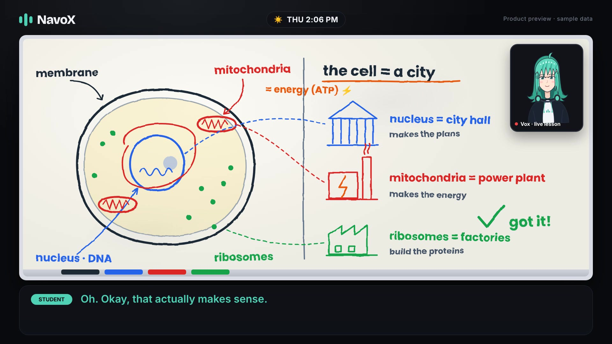

# NavoX

**A voice-first AI assistant for college students.**

NavoX brings conversations, classes and study planning into one place. The goal is simple: help students understand what needs their attention and take the next useful step.

[Visit NavoX](https://navox.net) · [Watch the demo](https://michaelbaffourawuah.com/projects/navox-pitch-voiced-20261031.mp4)

## Product focus

- **Vox:** a natural voice conversation about the student's classes, schedule and questions.
- **Today:** a clear starting point for daily priorities, classes and study.
- **Planning and connections:** calendars and study time, with student approval before making changes.
- **Memory:** useful context across conversations, with controls to review, edit and forget saved information.
- **Noa:** the companion inside Vox, with focus sessions and progress rewards.
- **NavoX Board:** a visual tutor for working through questions and course materials.

## Development status

NavoX is in active development. This page describes the product direction; it is not a claim that every feature has shipped or passed acceptance testing.

Vox and Noa are being tested. Board work is in progress. Real-phone acceptance testing, student testing and usage targets remain part of the release process.

The **2 minute 44 second demo is a scripted product preview**, using generated student and Vox voices, music and authored sample data. It illustrates the intended experience; it is not evidence that a live provider action, connection or acceptance test succeeded.

## High-level architecture

| Layer | Technologies |
| --- | --- |
| Web application | Next.js and TypeScript |
| Application API | Python and FastAPI |
| Data and background work | PostgreSQL and Temporal |
| Voice | LiveKit and speech-model providers |
| Deployment | Docker-based services |

## About this repository

This is NavoX's public product showcase. Application source code, implementation specifications, credentials and internal test evidence are maintained privately.

Built by [Michael Baffour Awuah](https://michaelbaffourawuah.com).

## Rights and media

No open-source license is granted by this repository. Project materials remain subject to their owners' rights. The preview may contain third-party media; publication here does not grant redistribution rights to those assets.
